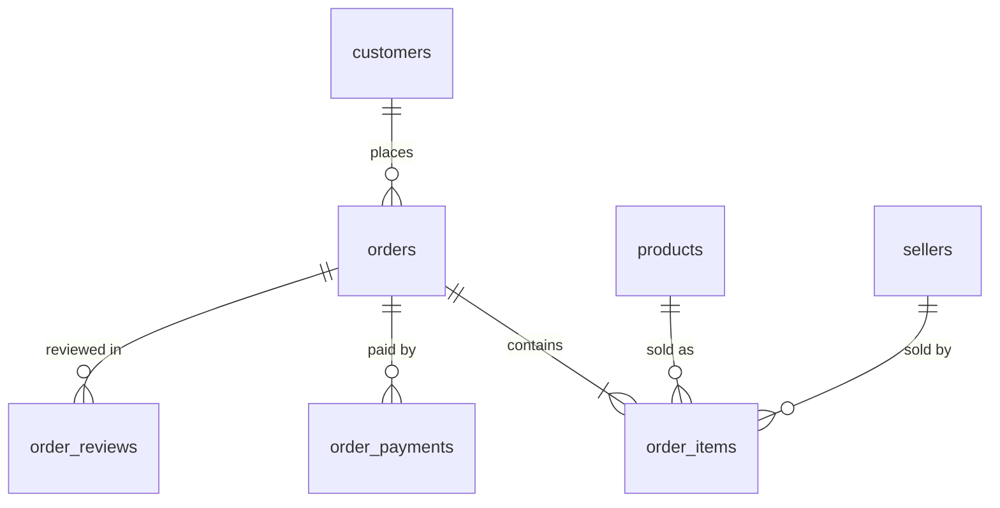

# ecommerce-lakehouse
This is a repo to simulate the ETL done for a e-commerce with high volume traffic

## Source system

The source is a Postgres database (`shop`, schema `app`) that plays the role of the e-commerce operational system. It is seeded with the [Olist](https://www.kaggle.com/datasets/olistbr/brazilian-ecommerce) Brazilian e-commerce dataset and then kept moving by a generator that inserts, updates and deletes rows, so the pipeline has real change events to capture.

| File | Role |
|---|---|
| `generator/01_schema.sql` … `08_order_reviews.sql` | DDL, run in numeric order |
| `generator/load_olist.py` | One-off bulk load of the Olist CSVs from `data/olist/` (`--truncate` to reload) |
| `generator/live_generator.py` | Endless loop that simulates live shop activity |

### Schema



| Table | Primary key | Foreign keys | Notes |
|---|---|---|---|
| `customers` | `customer_id` | | `customer_unique_id` identifies the person and repeats across their orders |
| `sellers` | `seller_id` | | |
| `products` | `product_id` | | Weight and dimensions are `NUMERIC`; counts are `SMALLINT` |
| `orders` | `order_id` | `customer_id` | Five nullable timestamps fill in as the order progresses |
| `order_items` | `(order_id, order_item_id)` | `order_id`, `product_id`, `seller_id` | `price` and `freight_value` are `NUMERIC(10,2)` |
| `order_payments` | `(order_id, payment_sequential)` | `order_id` | One order can be paid in several parts; has an extra `currency` column (default `BRL`) |
| `order_reviews` | `(review_id, order_id)` | `order_id` | See below for why the key is composite |

Every table has an `updated_at TIMESTAMPTZ` column defaulting to `NOW()`. The generator only refreshes it on `orders`, the one table it updates.

Identifiers (`customer_id`, `order_id`, and so on) are `TEXT`, because Olist uses 32-character hex strings. Generated ids use `uuid4().hex` so they look the same.

Composite keys exist where no single column is unique. `order_reviews` needs one because `review_id` repeats: in the Olist data, 789 review ids appear on more than one order, with identical content and different `order_id`s. The reasoning is in [`docs/order_reviews_key.md`](docs/order_reviews_key.md).

### Mess types

The generator deliberately writes some dirty data, so the silver layer has real cleaning to do. When a customer is created, the city is corrupted with probability `MESS_RATE` (default `0.1`, set in `.env`). The corruption is one of four types, picked at random:

| Mess type | Example | Why it exists |
|---|---|---|
| Lowercase | `São Paulo` → `são paulo` | Casing differences split one city into several groups in `GROUP BY` and break joins on the raw value |
| Uppercase | `São Paulo` → `SÃO PAULO` | Same as above, from the other direction |
| Padded whitespace | `São Paulo` → `  São Paulo ` | Invisible leading and trailing spaces make equal-looking values compare as different |
| Accents stripped | `São Paulo` → `Sao Paulo` | The same place spelled with and without diacritics is a duplicate entity that needs normalizing |

These four are the realistic result of free-text entry, different front-ends and legacy exports. They are cheap to detect with a data-quality test and cheap to fix with `trim`, `lower` and accent normalization, which makes them a good first set of rules for the silver models. Only the generator's new customers are affected. The Olist history is loaded as-is.

### Quirks inherited from Olist

These come from the original dataset, not from the generator:

- `review_id` is not unique (see above).
- About 610 products have no category, name length, description length or photo count, and 2 have no weight or dimensions.
- The source misspells `product_name_lenght` and `product_description_lenght`. `load_olist.py` renames them to `..._length` on load.
- The customers CSV calls the zip column `customer_zip_code_prefix`; the table uses `customer_zip_code`. The loader maps it.
- `order_payments.payment_type` includes `not_defined`, and `payment_installments` can be `0`.

### Live activity

`live_generator.py` picks one action per tick (every `SLEEP_SECONDS`, default 1) by weight. Each action runs in its own transaction.

| Action | Weight | Effect |
|---|---|---|
| `create_order` | 50% | New order with 1–3 items and one payment, status `created` |
| `advance_order_status` | 25% | Moves an open order one step along `created → approved → invoiced → processing → shipped → delivered`, filling the matching timestamp. Orders can be canceled (`CANCEL_RATE`, default 3%) before they ship |
| `create_customer` | 20% | New customer, possibly with a messy city |
| `delete_review` | 5% | Hard-deletes one review, so change capture has to handle deletes |

### Running it

```bash
colima start --cpu 4 --memory 8      # or start Docker Desktop
docker compose up -d                 # starts Postgres and runs the DDL
docker logs shop_db                  # check the schema scripts ran cleanly
uv pip install "psycopg[binary]" faker python-dotenv
python generator/load_olist.py       # bulk-load the Olist history
python generator/live_generator.py   # start the live traffic
```

`.env` must define `PG_USER`, `PG_PASSWORD` and `PG_PORT`. `MESS_RATE`, `CANCEL_RATE` and `SLEEP_SECONDS` are optional.
